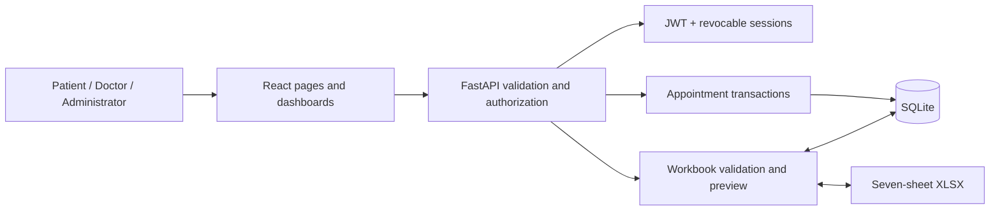

# Architecture

React/Vite/TypeScript routes call same-origin `/api` endpoints. FastAPI authenticates a signed JWT in an HttpOnly, SameSite=Strict cookie and checks its server-side session record. Database role and active status are rechecked on every request. Scrypt hashes passwords with random salts; credentials never enter the workbook.

SQLite uses foreign keys, WAL, bounded lock waits and `BEGIN IMMEDIATE` transactions. The availability/booking/payment/notification writes occur in one transaction. A partial unique index permits only one noncancelled appointment per slot. Failed simulated payments roll back before creating records. Rescheduling reserves the new slot and releases the old slot together. All clinic times are Asia/Kolkata.

Entities: User has one Patient or Doctor profile; Administrator is a User role. Doctor owns Availability slots. Appointment connects Patient, Doctor and slot. Payment is unique per appointment. Notifications belong to a user and optionally an appointment. Sessions are separate from exportable business data. Specializations are normalized for administrator management.

Entity/boundary/control mapping: React auth/booking/payment screens are boundaries; API route dependencies, `appointments.py` and `excel.py` are controllers/services; SQLite tables are entities. This implements the class-model responsibilities without forcing Java-style inheritance onto SQL.

The import parser enforces sheet/header shape, size limits, typed fields, IDs, foreign keys, role/profile consistency, no overlapping schedules, booking-slot agreement, and matching simulated payment state. Validation starts a real transaction and rolls it back; import repeats validation and commits. Export takes a consistent read snapshot and atomically replaces the local workbook.
